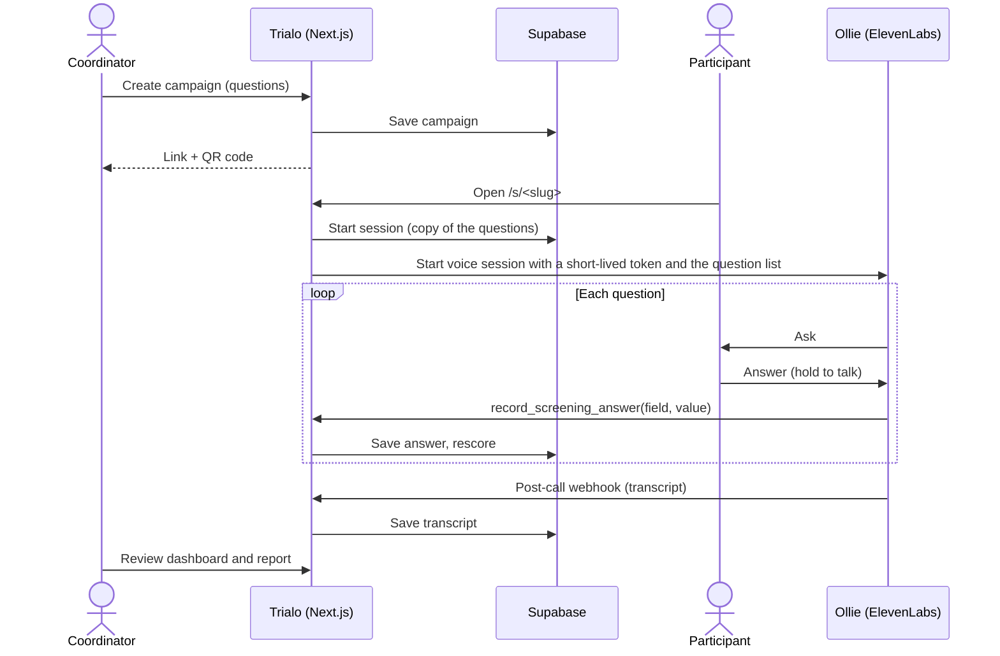

<p align="center">
  
</p>

<h1 align="center">Trialo</h1>

<p align="center"><strong>🏆 HackRU Winner</strong></p>

<p align="center">
  <strong>Clinical-trial pre-screening by voice.</strong><br>
  A coordinator shares a link or QR code, a participant has a short conversation with Ollie,<br>
  and the research team gets structured answers and a preliminary summary to review.
</p>

<p align="center">
  <a href="https://youtu.be/p8G9bIwuqiw"><strong>Watch the demo video</strong></a> ·
  <a href="https://trialo-regen.netlify.app">Live app</a> ·
  <a href="#getting-started">Getting started</a> ·
  <a href="#configure-ollie-elevenlabs">Configure Ollie</a> ·
  <a href="#limitations-and-responsible-use">Limitations</a>
</p>

<p align="center">
  
  
  
  
  
  
  
</p>

> [!IMPORTANT]
> Trialo is a working prototype built at HackRU for the Regeneron and ElevenLabs tracks, where it was one of the winning projects. It uses **synthetic demo data only**. It is not a medical device and never decides eligibility: every result is a preliminary summary for clinical research staff to review.

## Demo

<p align="center">
  <a href="https://youtu.be/p8G9bIwuqiw"></a>
</p>

- **Video (2:43):** [youtu.be/p8G9bIwuqiw](https://youtu.be/p8G9bIwuqiw). The same file is in this repo as [`trialo-demo.mp4`](trialo-demo.mp4).
- **Try it:** open the [live app](https://trialo-regen.netlify.app), press **Demo** on the portal to explore the sample campaigns and sessions, and scan any campaign's QR code with your phone to talk to Ollie.

## What it does

**For coordinators**

- **Create a campaign:** name it, add screening questions (write them, paste them, or upload a CSV), review, and get a participant link and QR code.
- **Smart questions:** each question is *fits if yes*, *flag if yes*, or *info only*. Questions can depend on gender, an age range, or an earlier answer ("ask about inhaler use only if they have asthma").
- **Live dashboard:** sessions refresh every 5 seconds and show how far each person got. Each one reads *in progress*, *complete*, or *stopped early* (participant ended it, the call ended, or the connection dropped), with a review status: **Potential match for follow-up**, **Needs review**, or **Unlikely match**.
- **Session report:** every answer in interview order, which answers support or rule out each study, and the full call transcript.
- **One interview, many studies:** each participant's answers are also compared with your other campaigns' criteria, so the dashboard shows where else they may fit (*Potential match for follow-up*, *Needs review* or *Unlikely match*) without asking them to repeat a screening. The report shows which answer each match came from, and what still needs asking.
- **Private workspaces:** coordinators sign in (Clerk) and only see their own campaigns. A one-click demo account shows sample data.

**For participants**

- Scan a QR code, type a first name (optional), and talk to **Ollie**, an animated penguin with lip-synced speech and expressions.
- **Hold to talk:** the mic is live only while you hold the button (or the Space bar on a computer), so background noise never gets in.
- A clear counter ("Question 3 of 5"), large text, and a phone layout that fits one screen without scrolling.
- Skip any question or stop at any time. Answers so far are saved, and the closing screen says honestly whether the interview finished.
- No account, nothing to install: it runs in the phone's browser.
- A text-interview option is on the welcome screen but is still experimental (see [Limitations](#limitations-and-responsible-use)).

## How it works



- **Questions are versioned per session.** Each session keeps a copy of the questions it started with, so editing a campaign never changes interviews in progress or past reports.
- **Scoring is conservative.** A yes to a *fits* question supports a match; a no, or a yes to a *flag* question, may rule one out. "Not sure", "prefer not to say" and skipped questions are missing information that needs review, never an exclusion.
- **Cross-study matching is transparent.** An answer carries over to another study only when the participant answered the same question (same topic in any wording, with the same time frame) or it follows from their age. Everything else is shown as "not asked", never guessed.
- **Completion means every question that applies was answered.** Hanging up or receiving a transcript doesn't count as finishing.
- **Secrets stay on the server.** The browser gets a short-lived ElevenLabs conversation token; the ElevenLabs and Supabase keys never leave the server.

## Tech stack

| Area | Choice |
| --- | --- |
| App | [Next.js 16](https://nextjs.org) (App Router), React 19, TypeScript, plain CSS |
| Voice agent | [ElevenLabs Conversational AI](https://elevenlabs.io/conversational-ai) via `@elevenlabs/react` (client tool + post-call webhook) |
| Database | [Supabase](https://supabase.com) Postgres, accessed only from server routes |
| Auth | [Clerk](https://clerk.com) for coordinators; participants never sign in |
| Hosting | [Netlify](https://www.netlify.com) |

## Getting started

### Prerequisites

- Node.js **22.13+**
- A [Supabase](https://supabase.com) project, an [ElevenLabs](https://elevenlabs.io) agent, and a [Clerk](https://clerk.com) application

### 1. Install

```bash
git clone https://github.com/MaybeSam05/Trialo.git
cd Trialo
npm install
```

### 2. Set up the database

In the Supabase SQL Editor, run [`supabase/schema.sql`](supabase/schema.sql). It is idempotent: every statement is `create … if not exists` or `add column if not exists`, so re-running it on an existing database only adds what's missing.

### 3. Configure environment variables

```bash
cp .env.example .env.local
```

| Variable | Purpose |
| --- | --- |
| `NEXT_PUBLIC_SUPABASE_URL` | Supabase project URL |
| `SUPABASE_SERVICE_ROLE_KEY` | Supabase service-role key (server only) |
| `ELEVENLABS_API_KEY` | ElevenLabs API key (server only, used to mint conversation tokens) |
| `ELEVENLABS_AGENT_ID` | Ollie's agent ID |
| `NEXT_PUBLIC_CLERK_PUBLISHABLE_KEY`, `CLERK_SECRET_KEY` | Clerk keys. Without them, pages don't load |
| `NEXT_PUBLIC_CLERK_SIGN_IN_URL`, `NEXT_PUBLIC_CLERK_SIGN_UP_URL` | `/portal/sign-in` and `/portal/sign-up` |
| `NEXT_PUBLIC_CLERK_SIGN_IN_FALLBACK_REDIRECT_URL`, `NEXT_PUBLIC_CLERK_SIGN_UP_FALLBACK_REDIRECT_URL` | `/dashboard` |
| `NEXT_PUBLIC_APP_URL` | Optional base URL for participant links and QR codes |

### 4. Run

```bash
npm run dev
```

Open http://localhost:3000, sign up at `/portal/sign-up`, and create a campaign. Use **Use the demo preset** for a ready-made three-question asthma study.

> [!TIP]
> If sign-in keeps looping back to the portal locally, sync your computer's clock. Clerk session tokens are sensitive to clock drift.

## Configure Ollie (ElevenLabs)

1. **Client tool.** Add a client tool named `record_screening_answer`, set to block the agent while it runs, with two string parameters:
   - `field`: the question's field name
   - `value`: the participant's confirmed answer
2. **Dynamic variables.** Declare these in the agent; Trialo fills them in when each session starts:
   - `{{study_name}}`: the campaign name
   - `{{participant_name}}`: the name the participant typed (may be empty)
   - `{{study_questions}}`: the full question list, with profile questions first and each question's `[field: …]` name and "only if" rule
3. **System prompt.** Include something like:
   > Ask the questions in {{study_questions}} one at a time, in order, in plain language. Skip a question only when its "only if" rule clearly doesn't match an earlier answer. After the participant confirms an answer, call `record_screening_answer` with `field` set to the exact field name in brackets and `value` set to their answer. Never tell the participant whether they are eligible.
4. **Post-call webhook.** Point it at `https://YOUR_DOMAIN/api/elevenlabs/post-call`. It stores the transcript for the session report.
5. **Agent settings.** Hold-to-talk sends silence between answers, and every screening question is about health, so:
   - **Guardrails:** don't enable guardrails that block medical or health topics. With one on, the ElevenLabs server ends the call ("Server error") as soon as Ollie asks the first health question, right after age and gender.
   - **Silence end-call timeout:** off, or several minutes. A short value hangs up while the participant is reading or about to press the button.
   - **Turn timeout:** about 30 seconds. **Max conversation duration:** 10 minutes or more.
   - **End call:** only when the interview is finished or the participant asks to stop.

### Troubleshooting voice interviews

| Symptom | Likely cause |
| --- | --- |
| Call ends right after the gender question; the browser console shows `Server error: Unknown error` | An agent guardrail is blocking health topics (step 5) |
| Call ends after 10–15 seconds without anyone speaking | Silence end-call timeout is too short |
| "Ollie's call ended" on the dashboard, but no transcript in the report | Check the post-call webhook URL (step 4) |
| Participant can't be heard | The browser blocked the microphone; allow it in the browser's site settings and reload |

Each session records how it ended (participant, Ollie's call ended, or connection dropped), and the interview page logs `[Trialo] conversation ended` with the reason in the browser console.

## Screening questions

Coordinators build questions in the app, or upload a CSV like this (a template can be downloaded from the editor):

```csv
id,question,type,study,ask_if,min_age,max_age
allergies,Do you have seasonal allergies?,fit,Trial A,,12,
allergy_medicine,Do you take allergy medicine during allergy season?,fit,Trial A,allergies=yes,,
recent_cold,Have you had a cold or the flu in the last two weeks?,flag,Trial A,,,
womens_group,Would you join a women-only group session?,info,Trial B,gender=female,18,
```

| Column | Meaning |
| --- | --- |
| `type` | `fit` (a yes fits), `flag` (a yes may rule out), or `info` (collected, not scored) |
| `study` | Groups questions into separate study results within one campaign |
| `ask_if` | Ask only when an earlier answer matches, e.g. `gender=female` or `allergies=yes` |
| `min_age`, `max_age` | Ask only within an age range |

Every interview starts with two profile questions, age and gender. The participant's name is typed on the welcome screen rather than spoken, because names are easy to mishear.

## Demo data

```bash
npm run seed:demo        # three synthetic campaigns and about 55 sessions over two weeks
npm run demo:user        # create (or reset) the shared "trialo-demo" coordinator account
```

- Demo participants are synthetic patients generated with [Synthea](https://github.com/synthetichealth/synthea)™ (© The MITRE Corporation, Apache-2.0); no real people. Their age, gender, first name and answers about diagnoses, medicines and procedures come from each patient's simulated record in [`scripts/data/synthea-participants.json`](scripts/data/synthea-participants.json). To regenerate it, run Synthea with its CSV exporter and then `npx tsx scripts/synthea-extract.ts path/to/output/csv` (see the script for the exact command).
- `seed:demo` only replaces campaigns whose slug starts with `demo-`, so it's safe to re-run. It stops without changing anything if those campaigns belong to more than one account. Add `-- --clear-all` to wipe every campaign first, or run `npx tsx scripts/seed-demo.ts --dry-run` to preview without touching the database.
- `demo:user` prints a fresh password and gives the account every campaign without an owner. The portal's **Demo** button signs visitors into it with a one-time token.

## Scripts

| Command | What it does |
| --- | --- |
| `npm run dev` | Start the dev server |
| `npm run build` | Production build |
| `npm run lint` | ESLint |
| `npm test` | Regression checks for rules, scoring, progress, endings, webhooks and request handling (no network or database needed) |
| `npm run seed:demo` | Load synthetic demo data |
| `npm run demo:user` | Create or reset the demo coordinator account |

## Project structure

```text
src/
  app/
    page.tsx                  Create a campaign
    s/[slug]/                 Participant interview (public)
    dashboard/                Sessions board, campaigns, session reports
    portal/                   Coordinator sign-in and sign-up (Clerk)
    api/
      studies/                Create campaigns, edit questions
      public/[slug]/sessions  Start a session (public)
      sessions/[id]/          Save answers, link the conversation, record how the call ended
      elevenlabs/             Conversation tokens, post-call webhook
  components/
    voice-screening.tsx       ElevenLabs wiring: client tool, dynamic variables, hold-to-talk mic
    participant/              Welcome, interview screen, Ollie, speech bubble, talk button
    coordinator/              Question editor, campaign review and sharing
    dashboard/                Live sessions board, outcome and interview-state rules
  lib/
    questions.ts              Question model, conditions, scoring, progress, CSV parsing
    cross-match.ts            Compare one participant's answers with other studies' criteria
supabase/schema.sql           Tables and additive migrations
scripts/                      Demo seeding, demo account, Synthea import, regression checks
trialo-demo.mp4               The demo video (also on YouTube)
```

## Deployment

Trialo runs on Netlify (Next.js is detected automatically). Set the environment variables above in the Netlify site settings, run `supabase/schema.sql` on the production database, and update Ollie's post-call webhook URL to the deployed domain.

## Limitations and responsible use

- **Synthetic data only.** Don't enter real health information. The participant screen says so too.
- **Not an eligibility decision.** Results are limited to *potential match*, *needs information* and *possible exclusion*, summarised as **Potential match for follow-up**, **Needs review** or **Unlikely match**, and always need review by qualified research staff.
- **Before any real use**, add webhook signature verification, role-based access and audit logs, data retention and deletion controls, protocol-reviewed criteria, and a formal privacy/HIPAA review.
- Voice-agent behaviour (which questions get asked, how answers are worded) depends on the ElevenLabs agent's prompt and settings; see [Configure Ollie](#configure-ollie-elevenlabs).
- **Text interviews are experimental.** The option exists, but with the current agent settings Ollie doesn't reply in text-only sessions and the call ends after a few seconds. Use voice for demos.

## License

[MIT](LICENSE) © 2026 The Trialo team
